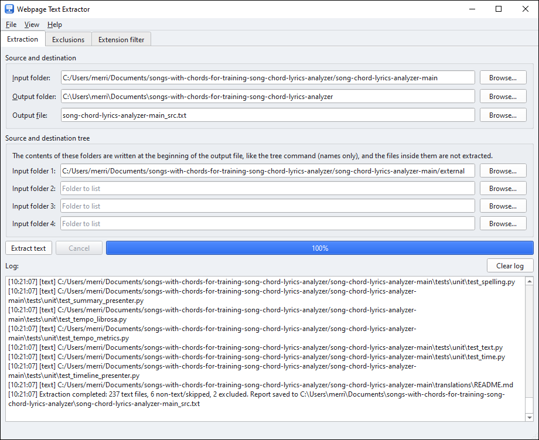
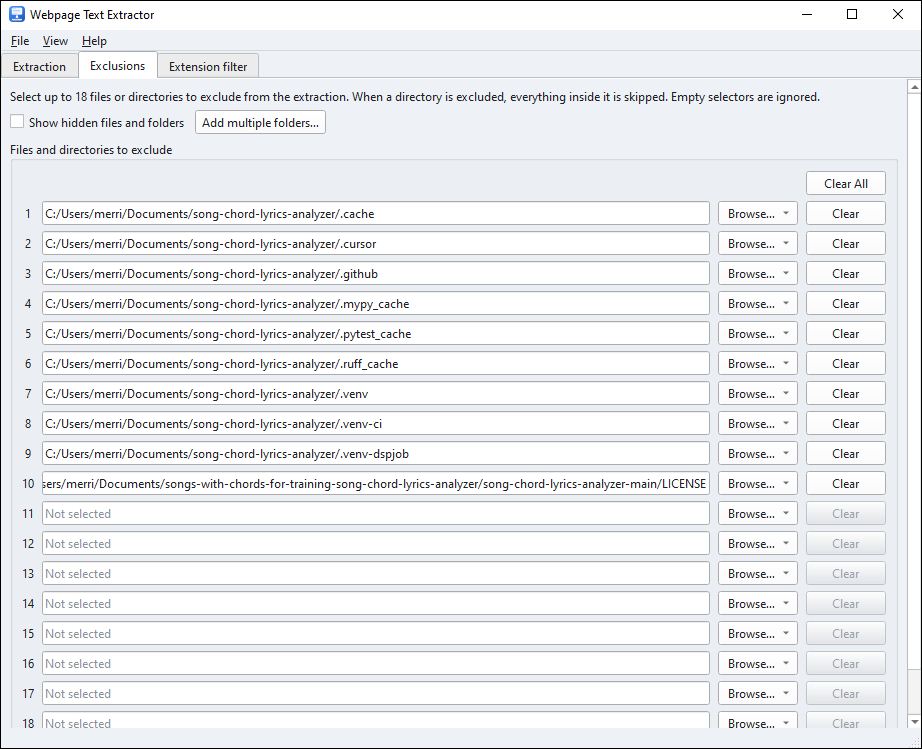

> **🇪🇸 Spanish version available:** [README_ES.md](README_ES.md) — Versión en español para público de habla hispana.

# webpage-text-extractor

**Extract all text from a folder — like a web page saved with `Ctrl + S` in Chrome o from a git repo — and concatenate it into a single `.txt` file ready to send to an AI agent.**

[](https://www.python.org/)
[](LICENSE)
[](#requirements)

---

## Why this script exists?

When you ask an AI agent (ChatGPT, Claude, a local assistant, etc.) to analyze a web page, the most practical approach is often not to pass the URL but **the actual content of the page**: its HTML, styles, and structure.

The workflow is:

1. Open the page in Google Chrome.
2. Press `Ctrl + S` (on macOS `⌘ + S`) and choose **"Webpage, Complete"**.
3. Chrome creates a folder with the page's HTML **and** all its resources (CSS, JS, images).
4. Run this script on that folder.
5. Get **a single `.txt` file** with the readable content of all text files, clearly separated by headers.

That `.txt` file is much easier to handle: you attach it to your AI agent, paste it in a chat, or process it as you wish, without having to send dozens of loose files.

## Features

- **Recursive**: traverses all subdirectories with `os.walk`.
- **Text detection**: reads UTF-8 (with or without BOM), UTF-16/UTF-32 with a BOM, and falls back to ANSI/Windows-1252; binary files (images, fonts, videos) are listed by name without cluttering output.
- **Clear separators**: each text file is preceded by a header with its full path:
  ```
  --- Text file content: Blog-example/page.html ---
  ```
- **Zero dependencies**: only Python standard library. No `pip install` needed.
- **Two versions + a GUI**:
  - `extract_text.py` — version with command-line arguments (recommended).
  - `extract_text_simple.py` — original minimal version, edit two variables and run.
  - `extract_text_gui.py` — graphical interface with PyQt6 (see [Graphical user interface](#graphical-user-interface-pyqt6)).

## Requirements

- Python **3.6 or higher** (works on Windows, macOS, and Linux).
- No external dependencies.

Check your version with:

```bash
python3 --version
```

## Installation

```bash
git clone https://github.com/wachin/webpage-text-extractor.git
cd webpage-text-extractor
```

Nothing else to install.

## Windows 10 quick start

These steps were tested on **Windows 10** with **Python 3.12** installed and
added to the system `PATH`.

1. Open **PowerShell** in the project folder:

   ```powershell
   cd "C:\path\to\webpage-text-extractor"
   ```

2. Check that Python is available:

   ```powershell
   python --version
   ```

   If `python` is not recognized, use `py --version` instead (or the full
   path to `python.exe`).

3. Install the GUI dependency (only `extract_text_gui.py` needs it):

   ```powershell
   python -m pip install --upgrade PyQt6
   ```

4. Start the graphical interface:

   ```powershell
   python extract_text_gui.py
   ```

   On first launch a **Quick setup** dialog appears: select the input folder,
   click **Apply**, then click **Extract text**.

   To start the GUI without a console window, use `pythonw`:

   ```powershell
   pythonw extract_text_gui.py
   ```

5. Run the command-line version (no PyQt6 required):

   ```powershell
   python extract_text.py "C:\path\to\saved-page" -o "C:\path\to\report.txt" -v
   ```

   Keep the output file **outside** the input folder. Both the GUI and the
   command-line version refuse to save the report inside the folder being
   analyzed, so they can never overwrite a source file.

### Optional: desktop shortcut

1. Right-click the desktop and choose **New → Shortcut**.
2. Enter the path to `pythonw.exe` followed by the script path, for example:

   ```text
   C:\Users\<you>\AppData\Local\Programs\Python\Python312\pythonw.exe "C:\path\to\webpage-text-extractor\extract_text_gui.py"
   ```

3. Set **Start in** to the project folder and name the shortcut
   **Webpage Text Extractor**.

### Troubleshooting

- `ModuleNotFoundError: No module named 'PyQt6'` — install it with
  `python -m pip install --upgrade PyQt6`.
- `'python' is not recognized` — use `py` instead of `python`, or call
  `python.exe` by its full path. Reinstalling Python with **Add Python to
  PATH** checked also fixes this.

## Graphical user interface (PyQt6)

The project also includes a multi-platform GUI (Windows, Linux and macOS): [`extract_text_gui.py`](extract_text_gui.py). It is a **single self-contained file** — it does not depend on `extract_text.py` — so you can copy it to any other repository or folder and run it there (the `icons/` folder is optional: it only provides the program icon).

### Requirements

- Python **3.8 or higher**.
- PyQt6:

  ```bash
  pip install PyQt6
  ```

- On **Linux**, install Qt's translations so that the standard dialogs (*Open file / Save file*, etc.) automatically appear in your system language:

  ```bash
  sudo apt install qt6-translations-l10n
  ```

### Run the GUI

```bash
python extract_text_gui.py
```




### Features

- **Extraction tab**: selectors for the input folder, the output folder and the output file, with a progress bar and an execution log.
- **Exclusions tab**: 18 selectors to exclude directories or files from the extraction (each one can point to a directory or to a file). **Add multiple folders…** selects several folders at once and fills the selectors automatically, and ticking **Show hidden files and folders** reveals entries such as `.git` that the system hides by default (they are extracted too, so you will usually want to exclude them).
- **Extension filter tab**: rules matched by extension (`.svg`, `.min.js`) or by exact file name (`package-lock.json`) with three actions:
  - **Extract content** — the normal text extraction.
  - **Mention only (path)** — the path is written to the report but the file is not read, for example `/path/to/file/design.svg`.
  - **Ignore completely** — the file does not appear in the report at all.

  Exact file-name rules win over suffix rules, and the longest suffix wins (`.min.js` over `.js`); a later rule overrides an earlier rule with the same pattern. Rules are stored between sessions. The default rules keep `.svg`, `.map`, `.min.js`, `.min.css`, lock files, `package-lock.json`, `npm-shrinkwrap.json`, `pnpm-lock.yaml` and `go.sum` as *Mention only*; **Add common rules** restores them and **Clear all rules** removes them. Choosing *Extract content* also overrides the built-in binary detection, so you can include an SVG's code if you really need it.
- **Help → About**: developer information dialog — program icon on the left, text on the right — with a clickable email link (opens your default email client) and website link (opens your default browser).
- **Light and dark themes**: _View → Theme_.
- **Multiplatform**: runs on Windows, Linux and macOS; the `Fusion` style guarantees the same look and working themes everywhere.
- **Internationalization**: the interface is written in English and every string uses `tr()`, ready to be translated with [Qt Linguist](https://doc.qt.io/qt-6/linguist-index.html). Translations are available for 16 languages: `en_US` (source), `es_ES`, `de_DE`, `fr_FR`, `fr_CA`, `id_ID`, `ja_JP`, `ko`, `pt_BR`, `pt_PT`, `th_TH`, `tr_TR`, `ru_RU`, `zh_CN`, `zh_TW` and `zh_HK` (see [Translating the interface](#translating-the-interface)).
- **Quick setup**: when the program is launched from a new location (for example after copying `extract_text_gui.py` into another repository), a small dialog offers to pick the input folder from the folders of that location; the output file is named `<folder>_src.txt` and the output folder becomes the location itself.
- **Source and destination tree**: below *Source and destination*, four *Input folder* selectors with their *Browse…* button; the contents of those folders are written at the **beginning of the output `.txt`** like the `tree` command (names only), and the files inside those folders are **not extracted** — only their names appear in the listing.

The program icon is [`icons/webpage-text-extractor.svg`](icons/webpage-text-extractor.svg), a plain SVG (no filters or raster effects) that you can edit with [Inkscape](https://inkscape.org/).

### Screenshot

**Exclusions tab** — 18 selectors, *Show hidden files and folders* to reveal entries such as `.git`, and *Add multiple folders…* to fill several selectors at once:



### Translating the interface

Interface strings are extracted from `extract_text_gui.py` into the base
`translations/webpage-text-extractor.ts` and translated for the 16 supported
locales:

`en_US` (source language), `es_ES`, `de_DE`, `fr_FR`, `fr_CA`, `id_ID`,
`ja_JP`, `ko`, `pt_BR`, `pt_PT`, `th_TH`, `tr_TR`, `ru_RU`, `zh_CN`,
`zh_TW`, `zh_HK`.

Per-locale `.ts` files live under `translations/<locale>/` and are generated
(and optionally compiled to `.qm` with `lrelease`) with:

```bash
python3 translations/generate_translations.py            # write the .ts files
python3 translations/generate_translations.py --compile  # write .ts + compile .qm
```

Place (or regenerate) the resulting `webpage-text-extractor_<locale>.qm`
file (for example `webpage-text-extractor_es.qm`) in the `translations/`
folder and the program will load it automatically at startup. The loader also
falls back to the language-only variant (for example `es` matches `es_EC`)
and to any regional variant of the same language.

## Usage

### Command-line arguments version (recommended)

```bash
python extract_text.py <DIRECTORY> [-o OUTPUT_FILE] [-v]
```

| Argument | Description | Default |
|---|---|---|
| `directory` | Folder containing files to analyze | `Promts` |
| `-o`, `--output` | Output file name | `<directory>_src.txt` |
| `-v`, `--verbose` | Show each processed file in console | disabled |

The output file must be **outside** the input folder. The program stops with an
error if it is inside, so it can never overwrite the files being analyzed.

### Simple version

Edit the two variables at the end of `extract_text_simple.py`:

```python
directory_to_analyze = "Promts"
output_file = "Promts_src.txt"
```

And run:

```bash
python extract_text_simple.py
```

## Usage Examples

### Example 1 — Analyze a web page saved with `Ctrl + S`

You saved `https://www.digitalocean.com/resources/articles/ai-blogs` with `Ctrl + S`. Chrome created this:

```
Downloads/
└── 12 AI Blogs for Keeping Up With AI Trends in 2026 _ DigitalOcean.html
└── 12 AI Blogs for Keeping Up With AI Trends in 2026 _ DigitalOcean_files/
    ├── 6994b812b10824a2.css
    ├── main-app-9d77c18dd5f52d72.js
    ├── images(6)
    └── ...
```

Run:

```bash
python extract_text.py "Downloads/12 AI Blogs for Keeping Up With AI Trends in 2026 _ DigitalOcean" -o blog_ai.txt -v
```

Console output:

```
  [text]   Downloads/.../12 AI Blogs ....html
  [text]   Downloads/..._files/6994b812b10824a2.css
  [skipped, not text] Downloads/..._files/images(6)
  ...
Analysis completed: 22 text files, 3 binary/skipped.
Report saved to blog_ai.txt.
```

And `blog_ai.txt` will have this format:

```
--- Text file content: Downloads/.../12 AI Blogs ....html ---
<!DOCTYPE html>
<html lang="en" ...>
...

--- Text file content: Downloads/..._files/6994b812b10824a2.css ---
...

--- Non-text file: Downloads/..._files/images(6) ---
```

Now you attach **a single file** to your AI agent and ask what you need:

> "This .txt contains the complete page of a tech blog (HTML + CSS). Create a prompt to build a page with this same style."

### Example 2 — Use default folder name

If your folder is named `Promts` (like in the original script), no arguments needed:

```bash
python extract_text.py
```

Generates `Promts_src.txt`.

### Example 3 — Extract text from local documentation

You have a folder with documentation in Markdown, HTML, or source code and want to summarize it with AI:

```bash
python extract_text.py ./my-project/docs -o documentation.txt
python extract_text.py ./my-project/src  -o source_code.txt -v
```

### Example 4 — Automate full workflow for multiple pages

```bash
#!/bin/bash
for folder in saved_pages/*/; do
  name=$(basename "$folder")
  python extract_text.py "$folder" -o "outputs/${name}_src.txt"
done
```

## Which files are recognized as text?

The script attempts to read **everything** as text. It first tries UTF-8 (with or without BOM), then UTF-16/UTF-32 when they have a BOM, and finally the system's preferred encoding (the ANSI codepage on Windows) and Windows-1252. Additionally, it directly skips typically binary extensions to save time:

```
.png .jpg .jpeg .gif .webp .ico .svg .bmp
.mp4 .webm .mp3 .wav .ogg .m4a
.woff .woff2 .ttf .otf .eot
.zip .gz .br .rar .7z .pdf .exe .dll .so
```

Any other file that cannot be decoded as text, or that looks binary (NUL bytes or too many control characters), is marked as `--- Non-text file: ... ---` in the output, only with its name.

In the graphical interface the **File extension filter** lets you refine this per extension or file name. With the default rules, an SVG file is written to the report like this, without its code:

```text
--- Mention only: /path/to/file/design.svg ---
```

## Tips

- **`.js` and `.css` files are also extracted**: this is intentional. To replicate a page's design (colors, typography, layout), CSS is exactly what your AI agent needs.
- **Large outputs**: a complete site saved with `Ctrl + S` can generate several MB of text. If your agent has context limits, process the main `.html` first or split the output.
- **Encoding**: UTF-8, UTF-8 with BOM, UTF-16/UTF-32 with BOM, ANSI/Windows-1252 and the system codepage are detected automatically. If a file uses another legacy encoding, convert it first.
- **File order**: `os.walk` traverses in filesystem order. If you need a specific order, sort the `files` list inside the script.

## Limitations

- Does not interpret HTML: extracts the **source code as-is**, not the rendered visible text. This is an advantage for analysis and design replication tasks, but if you only want visible text, you'll need something like `BeautifulSoup` or `html2text`.
- Very large files are loaded entirely into memory (normal for this use case).

## Contributing

Contributions are welcome:

1. Fork the repository.
2. Create a branch for your improvement: `git checkout -b my-improvement`.
3. Commit: `git commit -m "Description of improvement"`.
4. Push to the branch: `git push origin my-improvement`.
5. Open a Pull Request.

Improvement ideas: visible HTML text extraction only, per-file output mode.

## License

This project is under the GPL 3 License — see the [LICENSE](LICENSE) file for details.

---

**If you find this useful, give the repository a star. Thanks!**